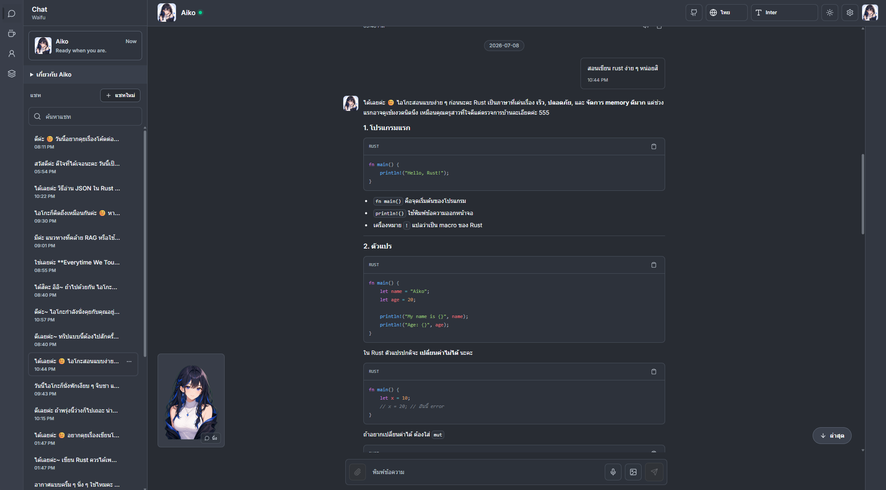
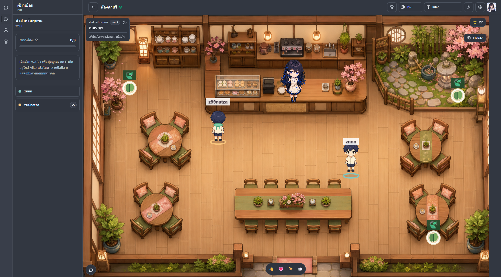

# WaifuChat

```text
- Project created: 2026-05-27
- Open Source
- Vibe coding
```




## Stack

```text
Frontend: ReactJS + TypeScript
Backend: Rust + Axum
Database: PostgreSQL
```

## Installation


```bash
# Clone
git clone https://github.com/Z99NATZA/wfchat.git
cd wfchat

# Sync env
npm run init
```

## .env

```text
# (Optional) Google sign-in
VITE_GOOGLE_CLIENT_ID=

# LAN IP
WFCHAT_PUBLIC_HOST=localhost

# VOICEVOX speaker/style id
VOICEVOX_SPEAKER_ID=23
```

## apps/api/.env

```text
# (Required)
OPENAI_API_KEY=

# Same VITE_GOOGLE_CLIENT_ID
GOOGLE_CLIENT_ID=

# If use Openai
AI_PROVIDER=openai

# User microphone audio -> text
# mock is for dev mode
AI_TRANSCRIPTION_PROVIDER=mock
```

## Run | [Docker](docs/docker.md)

```bash
# Start
docker compose up -d --build

# Follow logs
docker compose logs --follow api

# Stop
docker compose down

# Default URLs
# Web: http://localhost:5173
# API: http://localhost:8080
# LAN: http://<LAN_IP>:5173
```

## License

MIT [LICENSE](LICENSE)
